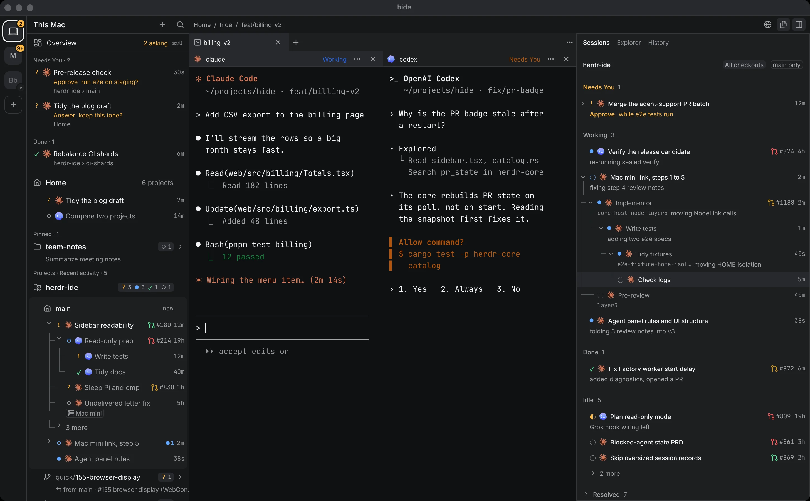
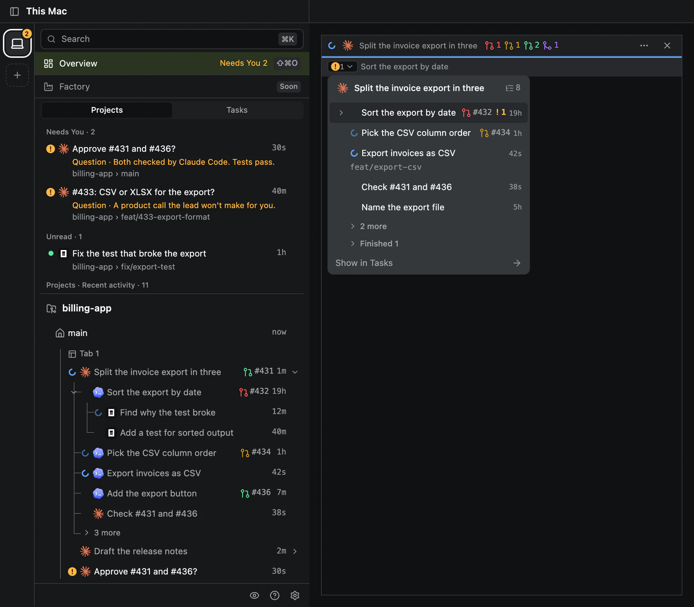
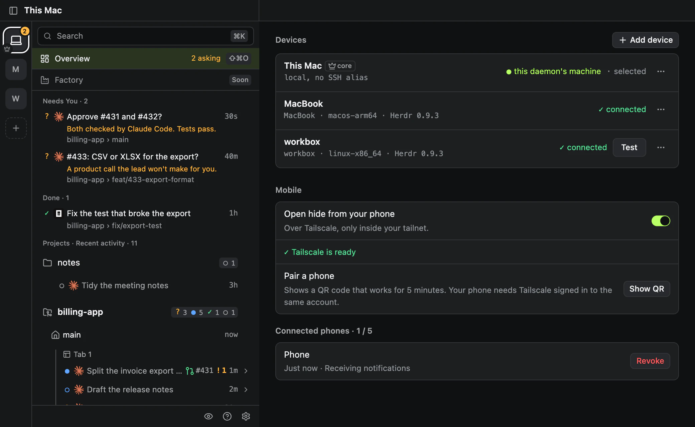

<p align="center">
  
</p>

<h1 align="center">hide</h1>

<p align="center">
  <strong>Run more agents. Hold less.</strong><br>
  The agent development environment for Claude Code, Codex and whatever comes next.
</p>

<p align="center">
  <a href="https://github.com/with-hide/hide/releases/latest"></a>
  <a href="LICENSE"></a>
  
  <a href="https://herdr.dev"></a>
</p>

<p align="center">
  <a href="https://withhide.dev">Website</a> ·
  <a href="#install">Install</a> ·
  <a href="docs/README.md">Docs</a> ·
  <a href="https://github.com/with-hide/hide/discussions">Discussions</a> ·
  <a href="CONTRIBUTING.md">Contributing</a>
</p>

<p align="center">
  
</p>

Your team runs several coding agents at once, and someone has to watch them.
hide keeps every agent in one view, lets them hand work to each other, and keeps them going after you close the laptop.
You get the decisions; the rest stays out of the way.

It works with the agent CLIs you already signed in to: **Claude Code, Codex, OpenCode, Cursor, Grok, Pi and omp**.
No new API key, no hosted service.

## Features

### Only what needs you comes up

Hide AI reads what each agent did and gives it a title and a one-line summary.
Agents sort themselves into four groups, **Needs You, Done, Working and Seen**, and the ones waiting on you sit on top of every screen.
Hide AI runs on the agent CLI you already use.

### Agents hand work to each other

A lead starts workers, a worker starts a helper, and they write to each other in letters.
Mix vendors freely: one agent writes, another checks.
A child runs in its own tab and reports to its parent, not to you, and the tree shows who started whom on every machine.

<p align="center">
  <picture>
    <source media="(prefers-color-scheme: light)" srcset="site/assets/shots/agents-light.webp">
    
  </picture>
</p>

### One core, any screen

Put hide's core on a machine that never sleeps.
Projects, letters and titles live there; your laptop becomes a screen, so closing it stops nothing.
Add any machine by its SSH alias and its agents join the same groups, and pair your phone by QR to answer the one that needs you.

<p align="center">
  <picture>
    <source media="(prefers-color-scheme: light)" srcset="site/assets/shots/core-light.webp">
    
  </picture>
</p>

### Still an IDE

- **Real terminals.** Agents run in Herdr panes with their real layout, scrollback and focus, drawn in place.
- **Files beside the work.** A path an agent names opens next to it, in an editor with a VS Code style Explorer.
- **Diffs and pull requests.** Each checkout's changes are one click from its tab, with its pull requests in the Work tool.
- **A browser your agents can drive.** `hide browser open <url>` shows a page beside the agent, which can click, fill and screenshot it.
- **Keyboard first.** `⌘K` goes to any agent, session, issue or pull request, and `⌘P` opens any file.

> [!NOTE]
> **Software Factory is coming.** Queue issues with clear requirements; workers take them in order, verify and merge them, and bring back only what needs a person.
> Email [hello@withhide.dev](mailto:hello@withhide.dev) to join the list, or watch this repository's releases.

## Install

Download the package for your system from the [latest release](https://github.com/with-hide/hide/releases/latest):

| System | Package | First launch |
| --- | --- | --- |
| macOS 14+, Apple Silicon | `hide-v<version>-macos-arm64.zip` | Opens like any app; v0.3.0 and earlier need Control-click, **Open** once |
| Windows x64 | `hide-v<version>-windows-x64.zip` | Unsigned: SmartScreen asks once, **More info**, **Run anyway** |
| Linux x64 | `hide-v<version>-linux-x64.tar.gz` | Unpack and run `hide-linux-x64/hide`; nothing installs system-wide |

Check the archive against its `.sha256` file before you open it.
Install and sign in to the agent CLIs you want hide to start; hide never asks for their credentials.
hide brings its own [Herdr](https://herdr.dev), and when a Herdr server is already running it opens on top of it as it is.

[Install hide](docs/INSTALL.md) covers checksums, Gatekeeper, each system's steps, updates, uninstalling and troubleshooting, and [What each system supports](docs/INSTALL.md#what-each-system-supports) records where each system stands.

<details>
<summary><strong>Build from source</strong></summary>

<br>

You need Rust with 2024 edition support, Node.js 22.12.0 or later and pnpm 10.

```sh
git clone https://github.com/with-hide/hide.git
cd hide
pnpm install --frozen-lockfile
HIDE_VERSION=0.0.0-local pnpm --dir desktop package
```

On macOS this writes an ad-hoc signed `hide.app`, a versioned zip and its SHA-256 file under `desktop/out/`; install it with:

```sh
sudo /usr/bin/ditto --rsrc --extattr --qtn desktop/out/hide-darwin-arm64/hide.app /Applications/hide.app
open /Applications/hide.app
```

`0.0.0-local` marks a local build; set the version you mean when packaging any other.
Windows and Linux source builds are in [Build and install from source](docs/INSTALL.md#build-and-install-from-source).

</details>

## Your machines, your sign-ins

- **Nothing hosted.** The app, the core and Hide AI run on machines you own, so your code goes only where your agent CLIs already send it.
- **Credentials stay with their tools.** Agent CLIs, SSH and Herdr keep their own sign-in state.
  The one thing hide reads is Codex's `auth.json` access token and account ID, which it sends to Codex's usage endpoint to show your usage.
- **Your Herdr is left alone.** A Herdr server that answers is used as it is and never stopped or replaced; when none answers, hide starts its bundled one, which keeps running after the app quits.
- **Your phone stays in your tailnet.** It reaches your machines over your own Tailscale.

## How it works

```text
Herdr server ─ panes, terminals and agent lifecycle
     │  versioned snapshots + terminal output
     ▼
herdr-core (Rust) ─ the one owner of hide's state
     │  typed events in, snapshot deltas out
     ▼
hided ─ the daemon and the `hide` CLI: loopback HTTP + a token WebSocket
     │
     ▼
web shell (React) ─ in the Electron app, or a browser on the same machine
```

The core owns the state behind one snapshot boundary, and the shell only renders it and sends user events back, so the screen never keeps a competing model of the session.
[ARCHITECTURE.md](docs/ARCHITECTURE.md) explains the boundaries and their reasons.

### Built on Herdr

<!-- herdr-provenance:start -->
hide distributes the [upstream Herdr release v0.9.3](https://github.com/herdrdev/herdr/releases/tag/v0.9.3).
The bundled binary's code is not modified by hide; a macOS release replaces only its ad-hoc signature with hide's Developer ID one, which notarization requires.
The weekly `herdr-update.yml` workflow proposes upstream stable releases with `--repo herdrdev/herdr`; updates must pass contract and runtime checks.
<!-- herdr-provenance:end -->

## Performance

On an M4 Pro Mac, the 2026-10-04 candidate measured **16.3 ms p95** from a renderer keydown to a complete nine-character echo in the terminal buffer, and its whole process tree held **549 MiB** idle and **622 MiB** with three busy terminals (RSS p95).
These are one machine's numbers on macOS, taken without quiescing it: they leave out key-to-photon latency and Windows and Linux, and no other app ran the same workload, so they claim nothing about relative speed.
[PERFORMANCE_RESULTS.md](docs/PERFORMANCE_RESULTS.md) has the method, the distributions and every limit.

## Documentation

| Guide | What it covers |
| --- | --- |
| [Install](docs/INSTALL.md) | Releases, source builds, devices, moving the core, updates and troubleshooting |
| [UI behavior](docs/UI_BEHAVIOR.md) | What every screen does |
| [Status model](docs/status-model.md) | How an agent's group and read state are decided |
| [Agent hooks](docs/agent-hooks.md) | What hide writes for each agent, and where |
| [Browser displays](docs/BROWSER_DISPLAYS.md) | `hide browser` and the pages drawn beside the work |
| [Architecture](docs/ARCHITECTURE.md) | The core, the daemon, the desktop host and the Herdr boundary |
| [All docs](docs/README.md) | Every current guide and what owns it |

## Contributing

hide is built in the open, and every change lands through a pull request that the `verify` workflow gates.
Read [CONTRIBUTING.md](CONTRIBUTING.md) for the gates and their local commands, and [AGENTS.md](AGENTS.md) for the rules every change follows.

```sh
pnpm install --frozen-lockfile
bash scripts/verify-cargo.sh test   # Rust suites
bash scripts/verify-web.sh          # web and desktop typecheck, lint, test and build
pnpm --dir desktop dev              # the desktop app, unpackaged, against this checkout's build
```

<details>
<summary><strong>Repository map</strong></summary>

<br>

| Path | What lives there |
| --- | --- |
| `desktop/` | The Electron desktop host, the app that ships |
| `web/` | The React web shell |
| `hided/` | The daemon and the `hide` CLI |
| `herdr-core/` | The platform-neutral Rust runtime that owns hide's state |
| `hide-platform/` | What differs between macOS, Windows and Linux, written once |
| `hide-agent-hooks/` | The only code that writes an agent's configuration file |
| `hide-ai/` | Background AI features on the operator's own agent CLIs |
| `hide-kit/` | The install kit and every path under `~/.hide` |
| `hide-*/` | The other supporting crates: sessions, memory, devices, projects, the Factory |
| `plugins/` | Herdr plugins shipped from this repository |
| `contracts/` | The pinned Herdr API contract |
| `design/` | The Pen design library and `tokens.json` |
| `site/` | [withhide.dev](https://withhide.dev) |

</details>

## Community and support

- **Questions and ideas:** [GitHub Discussions](https://github.com/with-hide/hide/discussions)
- **Bugs:** [GitHub issues](https://github.com/with-hide/hide/issues)
- **Security:** report privately as [SECURITY.md](SECURITY.md) describes, never in a public issue
- **Teams and everything else:** [hello@withhide.dev](mailto:hello@withhide.dev)

## License

hide is licensed under the [Apache License 2.0](LICENSE); [NOTICE](NOTICE) carries its copyright notice.
The bundled Herdr and other third-party components keep their own licenses, listed in [THIRD_PARTY_NOTICES](desktop/resources/THIRD_PARTY_NOTICES).
